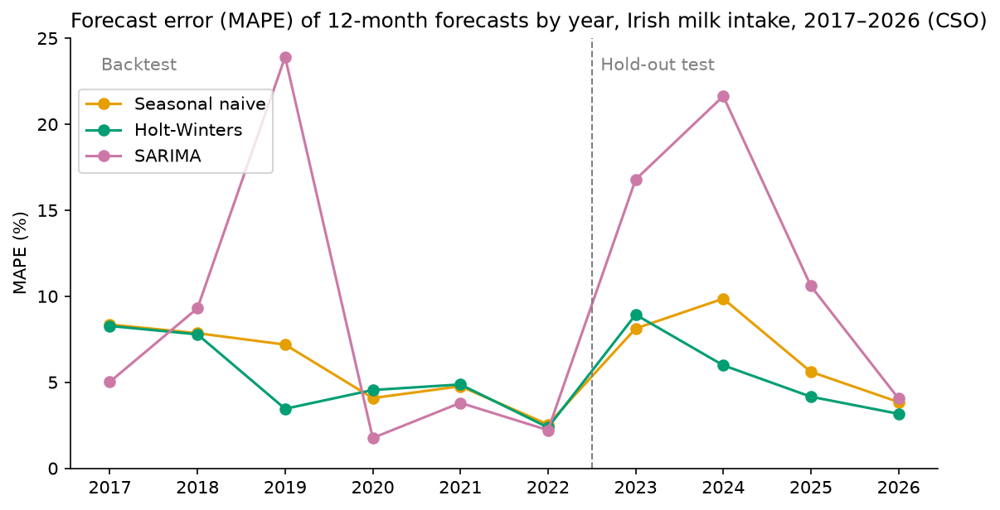
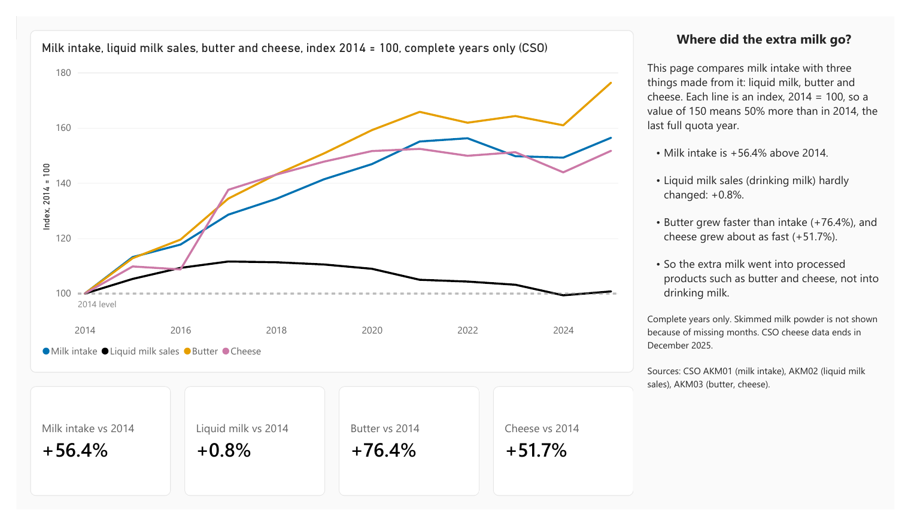
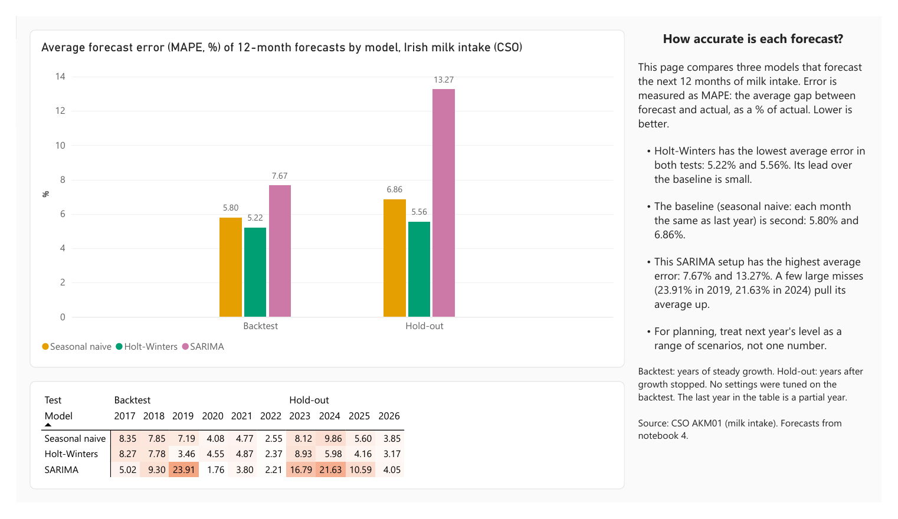

# What happened to Irish milk supply after quotas ended?

I wanted to know how Irish milk supply changed when EU milk quotas ended in 2015. I used CSO dairy statistics from January 1975 to August 2026. Milk intake in 2025 was 56.4% above 2014, and the extra milk went mainly into butter and cheese, not into drinking milk.

I cleaned the data in Python, loaded it into a SQL Server database, tested the change in trend with a regression, compared the seasonal pattern with Canada, tested three forecasting models and built a Power BI dashboard.

**Tools:** Python (pandas, statsmodels, matplotlib) · SQL Server (T-SQL, star schema) · Power BI (DAX) · Git


## Business questions
1. How did Irish milk supply respond when EU milk quotas ended in 2015?
2. Where did the extra milk go?
3. How seasonal is supply, and what does that mean for processing capacity?
4. Is milk composition (fat and protein) changing?
5. How accurately can monthly intake be forecast, and does the best model still work when the trend changes?

## Background: EU milk quotas
- The EU started milk quotas in April 1984 to limit over-production of milk.
- In 2003 the EU agreed to end quotas in 2015. From 2009 to 2013, quotas were raised by about 1% a year to prepare farmers.
- Quotas ended on 1 April 2015.

Sources: [Agriland (2015)](https://www.agriland.co.uk/farming-news/end-of-milk-quotas-why-dairy-quotas-were-introduced/); [European Commission JRC (2009)](https://publications.jrc.ec.europa.eu/repository/bitstream/JRC53116/jrc53116.pdf)

## Key findings
| # | Finding | Evidence |
|---|---|---|
| 1 | **Supply stayed flat under quotas and went up fast when they ended.** From 1985 to 2014, intake went up by about 0.1% a year. From 2014 to 2022 it went up by about 5.7% a year, and it has not grown since 2022. Intake in 2025 was 56.4% above 2014. | Compound growth rates for each period. Segmented trend on log yearly intake with Newey-West standard errors: the trend changed after 2015 (95% interval for the change in slope: 3.3 to 7.4 pp a year). Same result when I move the bend to 2013. |
| 2 | **The extra milk went into butter and cheese.** From 2014 to 2025, butter output went up about 76% and cheese about 52%. Liquid milk sales hardly changed (+0.8%), so drinking milk dropped from 8.5% to 5.5% of intake. | CSO AKM02, AKM03 |
| 3 | **Irish supply is very seasonal.** In 2016-2025, May intake was about 6.5 times January intake. Plants sized for the peak month would use about 62% of their capacity in an average month, compared with about 98% in Canada. | Average monthly profiles, CSO vs Statistics Canada |
| 4 | **Milk is getting richer.** Fat content went up from about 3.5% (1980) to about 4.3% (2025), and protein from about 3.2% to about 3.6%. Both are lowest in spring and highest in autumn. | Yearly values weighted by intake |
| 5 | **Holt-Winters was the most reliable forecast, but only by a little. This SARIMA setup was the least reliable.** Holt-Winters had the lowest average error in both tests, 0.6 and 1.3 points below the seasonal naive baseline. SARIMA was the best model in 4 of 6 backtest years, but it had the highest average error because of a few large misses (23.9% in 2019, 21.6% in 2024). | 12-month forecasts, retrained every December |

## Forecasting: how I tested the models
Every December I train each model on all data up to that month, and it forecasts the next 12 months. Then I compare the forecast with what really happened. I measure accuracy with MAPE (mean absolute percentage error, lower is better).

- **Backtest:** forecast years 2017-2022, a period of steady growth.
- **Hold-out test:** forecast years 2023, 2024, 2025 and January-August 2026, after growth stopped.

I did not tune any settings on the backtest, so the only difference between the two tests is the years they cover.

| Model | Backtest MAPE (2017-2022) | Hold-out MAPE (2023-Aug 2026) |
|---|---|---|
| Seasonal naive (same month last year) | 5.80% | 6.86% |
| Holt-Winters (multiplicative seasonality, damped trend) | **5.22%** | **5.56%** |
| SARIMA (0,1,1)(0,1,1)₁₂ on log intake | 7.67% | 13.27% |

A low MAPE alone does not make a model good. Just copying the same month from last year is already only 5.80% off in the backtest, so a model is only useful if it beats this baseline.



**Why this SARIMA setup misses:** SARIMA forecasts changes, not levels. When intake at the end of a year is much higher or lower than a year earlier, the model carries that change into the whole next year. Its yearly bias moves together with this late-year change (correlation 0.86 over 10 years). I fit the model on log intake, and every forecast starts from December, a month with very low intake. So this is a result for this setup, not for SARIMA in general.

**Takeaway:** I can forecast the seasonal pattern well, but not the trend. For capacity planning, I would use a model like Holt-Winters for the monthly profile and treat next year's level as a range of scenarios (for example, no growth or moderate growth), not one number. I chose the model settings before training and did not tune them.

## Power BI dashboard
I built six pages in Power BI Desktop (Import mode) from the SQL Server tables and the CSV file saved by notebook 4. Every page has the same layout: charts on the left, key numbers in cards below, and a note on the right with the question, the findings and the source.

Two pages are interactive. The Seasonality page has a year slicer: move it to an earlier period to see how the Irish season has changed. On the Explore page you can pick any of the eight measures and any range of years. The charts, their titles and the cards all change with the selection.

| Page | Question | What it shows |
|---|---|---|
| 1 Overview | What happened to Irish milk supply after quotas ended? | Yearly intake since 1975 with the quota period marked; key numbers from the other pages |
| 2 Seasonality | How seasonal is Irish milk supply? | Ireland vs Canada, each month as % of the average month, with a year slicer; peak month, lowest month and capacity use |
| 3 Products | Where did the extra milk go? | Intake, liquid milk, butter and cheese as an index (2014 = 100) |
| 4 Milk quality | Is milk getting richer? | Fat and protein content, weighted by intake |
| 5 Forecast accuracy | How accurate is each forecast? | Average MAPE by model and test, and MAPE for every model and year |
| 6 Explore the data | What does each measure look like? | Any measure by month and by calendar month, for the selected years |

**Page 1: Overview**


**Page 2: Seasonality**


**Page 3: Products**


**Page 4: Milk quality**


**Page 5: Forecast accuracy**


**Page 6: Explore the data**


The full dashboard as a PDF: [irish_dairy_dashboard.pdf](powerbi/irish_dairy_dashboard.pdf)

Two of the DAX measures behind the pages:

```dax
-- Each month as a % of the average month (Seasonality page).
-- REMOVEFILTERS clears the month on the chart axis, so the second
-- average covers all twelve months of the selected years.
Ireland, % of average month =
VAR month_average =
    CALCULATE(
        AVERAGE(fact_monthly[value]),
        dim_measure[measure_code] = "intake_ml"
    )
VAR all_months_average =
    CALCULATE(
        AVERAGE(fact_monthly[value]),
        dim_measure[measure_code] = "intake_ml",
        REMOVEFILTERS(dim_date[month], dim_date[month_name], dim_date[month_short])
    )
RETURN
    DIVIDE(month_average, all_months_average) * 100

-- Chart title that follows the measure slicer (Explore page).
Monthly chart title =
[Selected measure] & ", " & [Selected country] & ": by month (" & [Selected unit] & ")"
```

Rules I followed: complete years only for yearly totals; fat and protein always weighted by intake; the latest year is calculated, not typed; every number in a page note is also on that page. The forecast results go to Power BI through a CSV written by notebook 4, so the dashboard uses exactly the same numbers as the notebook.

## Repository structure
```
├── data/
│   ├── README.md                data dictionary for the clean files
│   ├── raw/                     CSO AKM01-03 (to Aug 2026, downloaded Sep 2026) and StatCan 32-10-0113-01 (to Jun 2026, downloaded Aug 2026)
│   └── processed/               clean tables written by notebooks 1 and 4
├── notebooks/
│   ├── 1_data_preparation.ipynb     inspect and clean the raw files
│   ├── 2_sql_database.ipynb         load the clean data into SQL Server
│   ├── 3_statistical_analysis.ipynb trend, quota effect, products, seasonality, fat and protein
│   └── 4_forecasting.ipynb          three models, backtest and hold-out test
├── sql/                         database scripts and analysis queries (see sql/README.md)
├── powerbi/                     dashboard (.pbix), PDF export and colour theme
├── figures/                     charts from notebooks 3 and 4, dashboard page images
└── requirements.txt
```

## Data dictionary
The columns of the three clean CSV files are in [`data/README.md`](data/README.md).

## How to run

1. **Clone the repo and set up Python** (Python 3.13, Git Bash on Windows):
   ```bash
   git clone https://github.com/temulenbd/irish-dairy-analysis.git
   cd irish-dairy-analysis
   python -m venv .venv
   source .venv/Scripts/activate
   pip install -r requirements.txt
   ```
2. **Create the database:** in SQL Server Management Studio, run `sql/00_create_database.sql`, then `sql/01_create_tables.sql`. This uses SQL Server on `localhost` with Windows Authentication and ODBC Driver 18. The schema is described in [`sql/README.md`](sql/README.md).
3. **Prepare the data:** run `notebooks/1_data_preparation.ipynb`. It reads the four files in `data/raw/` and writes the clean CSV files to `data/processed/`.
4. **Load the tables:** run `notebooks/2_sql_database.ipynb`.
5. **Optional:** run `sql/02_analysis_queries.sql` in SSMS. Notebook 3 gets the same results in Python.
6. **Run the analysis:** run `notebooks/3_statistical_analysis.ipynb`, then `notebooks/4_forecasting.ipynb`. They read from the database and write the figures. Notebook 4 also writes `forecast_mape_by_year.csv` for Power BI.
7. **Open the dashboard:** open `powerbi/irish_dairy_dashboard.pbix`. If the file path or server name is different on your computer, update it in Transform data → Data source settings, then click Refresh.

## Data sources

| Data | Source | Licence | Downloaded |
|---|---|---|---|
| [AKM01](https://data.cso.ie/table/AKM01): milk intake, fat and protein content | Central Statistics Office (CSO), data.cso.ie | [CC BY 4.0](https://creativecommons.org/licenses/by/4.0/) | September 2026 |
| [AKM02](https://data.cso.ie/table/AKM02): milk sales for human consumption | CSO | CC BY 4.0 | September 2026 |
| [AKM03](https://data.cso.ie/table/AKM03): production of dairy products | CSO | CC BY 4.0 | September 2026 |
| [Table 32-10-0113-01](https://www150.statcan.gc.ca/t1/tbl1/en/tv.action?pid=3210011301): milk production and utilization | Statistics Canada | [Statistics Canada Open Licence](https://www.statcan.gc.ca/en/reference/licence) | August 2026 |

Contains Irish Public Sector Data (Central Statistics Office) licensed under a Creative Commons Attribution 4.0 International (CC BY 4.0) licence. Adapted from Statistics Canada, Table 32-10-0113-01. This does not constitute an endorsement by Statistics Canada of this project.

## Limitations
- **National totals only.** There is no regional or co-op detail.
- **Skimmed milk powder has 40 months with no data,** all in October to February, when output is low. I kept them as missing and did not fill them in.
- **The regression intervals are approximate.** The regression uses 41 yearly values, and they have strong autocorrelation.
- **The regression uses one straight line after 2015.** Growth was fast until 2022 and then stopped. So the regression shows that the trend changed, and the growth rates for each period show by how much.
- **The capacity figure is a simple indicator.** It ignores storage and moving milk between plants.
- **Ireland and Canada are measured differently.** Irish intake by processors and Canadian milk sold off farms are not the same measure, so I compare only the seasonal shapes, not the levels.
- **The forecasts use only past intake.** Weather, milk prices and herd numbers are not in the models, and the results come from 10 forecast years.
- **MAPE gives more weight to winter months,** when intake is low.
- **I ran each forecasting model with one set of settings.** Other settings, for example SARIMA without the log, could give different results.
- **All numbers are from the 2026 downloads listed in Data sources.** A newer download will give slightly different numbers.

## About this project
This is an end-to-end portfolio project: public raw data, cleaning and checks in Python, a SQL Server database, statistical analysis, forecasting and a Power BI dashboard.

Some things I found in the data, and what I did about them:
- AKM01 has 1,729 empty cells out of 3,720. They are not errors: CSO does not publish fat and protein for imported milk, and imported intake only from 1998 to 2019. I kept only domestic data, and domestic intake has no gaps.
- The 40 missing skimmed milk powder months are all in October to February, when very little is produced. An average would add production that probably did not happen, so I kept them as missing.
- Cheese has 9 months with 0 production, all in December or January between 1980 and 1989. CSO reports them as values, so I kept them as 0.
- 2026 has only 8 months of data, so its total would look like a big drop in supply. I use complete years only for yearly totals.
- In 2016-2025, May had about 6.5 times as much milk as January. A simple average of the monthly fat values would give both months the same weight, so I weighted fat and protein by intake.
- The first regression had a Durbin-Watson statistic of 0.26, so the residuals were strongly autocorrelated. With Newey-West standard errors, growth under quotas (about 0.4% a year) was no longer significant (p = 0.07).
- Intake at the end of 2018 was 21.5% above a year earlier, and SARIMA's 2019 forecast was 23.9% too high. This SARIMA setup carries a change at the end of a year into the whole next year, and that is why it sometimes misses by a lot.

**Author:** Temuulen Bulgan, MSc Data Analytics, BSc Statistics and Economics · [LinkedIn](https://www.linkedin.com/in/temulenbd/)
