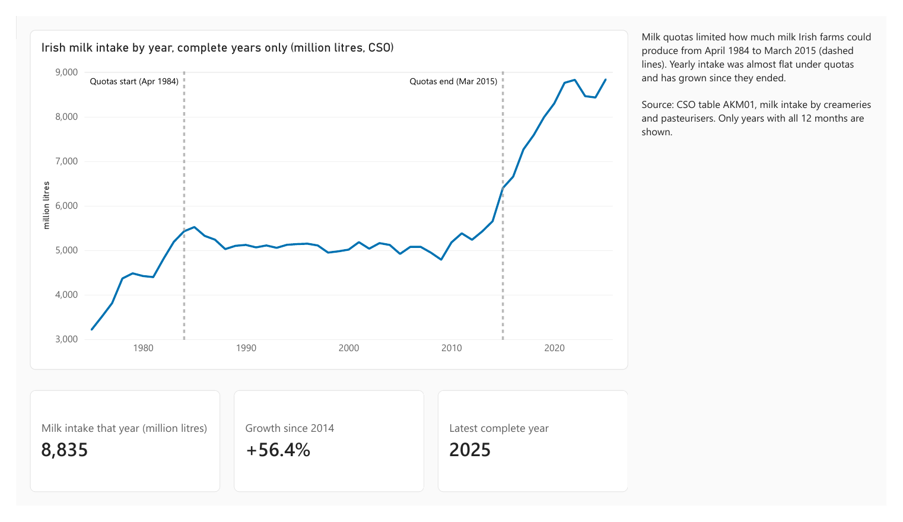
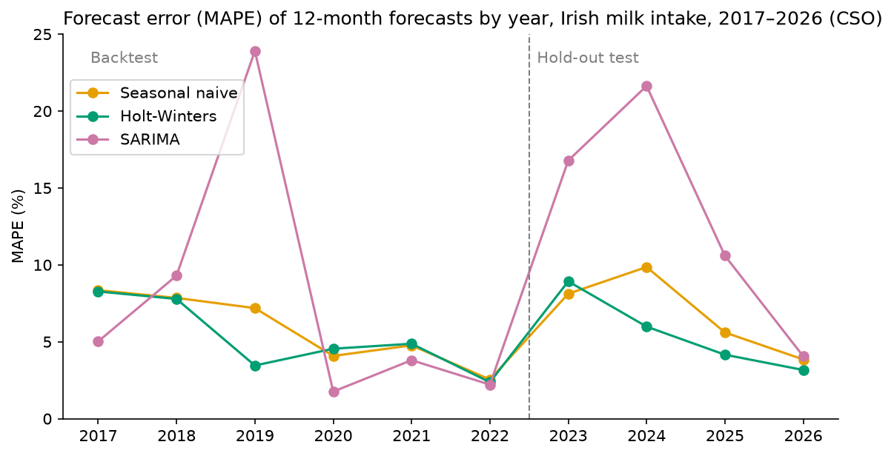
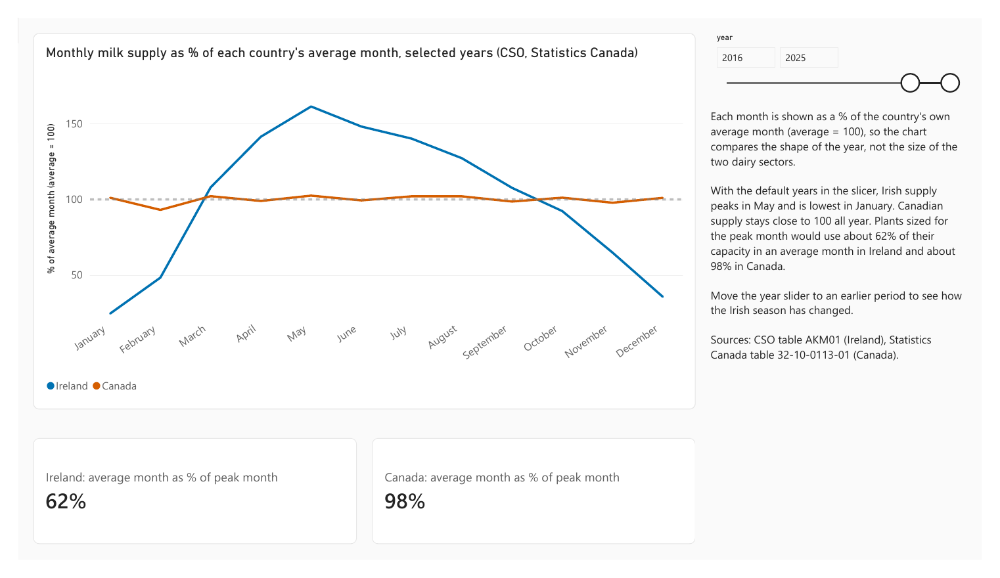
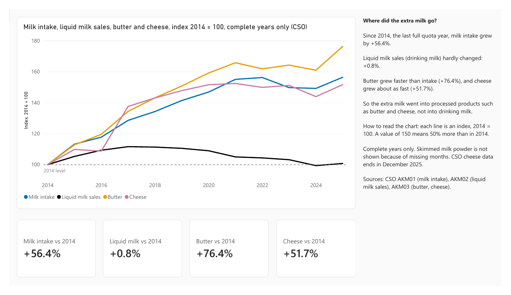
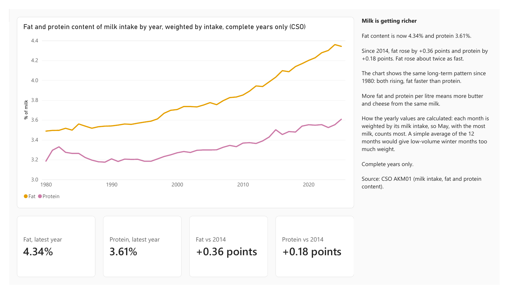
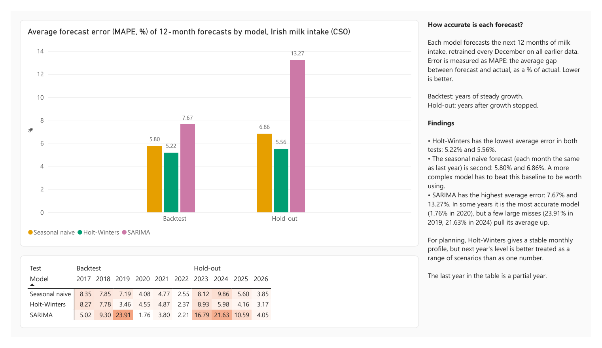

# Irish Milk Supply: Growth, Seasonality and Forecasting

An analysis of Irish dairy statistics from January 1975 to August 2026 (CSO), with a comparison to Canada, a SQL Server database, a Power BI dashboard and a test of three forecasting models.

**Tools:** Python (pandas, statsmodels, matplotlib) · SQL Server (T-SQL, star schema) · Power BI (DAX) · regression with Newey–West standard errors · time-series forecasting



## Business questions
1. How did Irish milk supply respond when EU milk quotas ended in 2015?
2. Where did the extra milk go?
3. How seasonal is supply, and what does that mean for processing capacity?
4. Is milk composition (fat and protein) changing?
5. How accurately can monthly intake be forecast, and does the best model still work when the trend changes?

## Background: EU milk quotas
- The EU introduced milk quotas in April 1984 to limit over-production of milk.
- In 2003 the EU agreed to end quotas in 2015. From 2009 to 2013, quotas were raised by about 1% a year to prepare farmers.
- Quotas ended on 1 April 2015.

Sources: [Agriland (2015)](https://www.agriland.co.uk/farming-news/end-of-milk-quotas-why-dairy-quotas-were-introduced/); [European Commission JRC (2009)](https://publications.jrc.ec.europa.eu/repository/bitstream/JRC53116/jrc53116.pdf)

## Key findings
| # | Finding | Evidence |
|---|---|---|
| 1 | **Quotas held supply flat.** From 1985 to 2015, intake grew by about 0.4% a year, not significantly different from zero. After quotas ended, growth was about 5 percentage points a year faster. Intake rose 56.4% from 2014 to 2025. | Segmented trend on log yearly intake, Newey–West standard errors: change in growth 95% interval 3.3 to 7.4 pp a year. The same result with the bend moved to 2013. |
| 2 | **The extra milk went into butter and cheese.** From 2014 to 2025, butter output rose about 76% and cheese about 52%. Liquid milk sales hardly changed (+0.8%), so drinking milk fell from 8.5% to 5.5% of intake. | CSO AKM02, AKM03 |
| 3 | **Irish supply is very seasonal.** In 2016–2025, May intake was about 6.5 times January intake. Plants sized for the peak month would use about 62% of their capacity in an average month, against about 98% in Canada. | Average monthly profiles, CSO vs Statistics Canada |
| 4 | **Milk is getting richer.** Fat content rose from about 3.5% (1980) to about 4.3% (2025), and protein from about 3.2% to about 3.6%. Both are lowest in spring and highest in autumn. | Yearly values weighted by intake |
| 5 | **Holt-Winters was the most reliable forecast; SARIMA the least.** Holt-Winters had the lowest average error in both tests. SARIMA was the best model in 4 of 6 backtest years but had the highest average error, because of a few large misses (23.9% in 2019, 21.6% in 2024). | 12-month forecasts, retrained every December |

## Forecasting: how the models were tested
Every December each model is trained on all data up to that month and forecasts the next 12 months. The forecast is then compared with what really happened. Accuracy is measured as MAPE (mean absolute percentage error, lower is better).

- **Backtest:** forecast years 2017–2022, a period of steady growth.
- **Hold-out test:** forecast years 2023, 2024, 2025 and January–August 2026, after growth stopped.

| Model | Backtest MAPE (2017–2022) | Hold-out MAPE (2023–Aug 2026) |
|---|---|---|
| Seasonal naive (same month last year) | 5.80% | 6.86% |
| Holt-Winters (multiplicative seasonality, damped trend) | **5.22%** | **5.56%** |
| SARIMA (0,1,1)(0,1,1)₁₂ on log intake | 7.67% | 13.27% |



**Why SARIMA misses:** SARIMA forecasts changes, not levels. When intake at the end of a year is much higher or lower than a year earlier, it carries that change into the whole next year. Its yearly bias moves with the late-year change (correlation 0.86 over 10 years).

**Takeaway:** the seasonal pattern can be forecast well, the trend cannot. For capacity planning, I would use a model like Holt-Winters for the monthly profile and treat next year's level as a range of scenarios (for example, no growth or moderate growth), not one number. Model settings were fixed in advance and not tuned.

## Power BI dashboard
Five pages, built on the SQL Server database. The full report is in [`powerbi/irish_dairy_dashboard.pdf`](powerbi/irish_dairy_dashboard.pdf) (the `.pbix` file is in the same folder).

| Page | What it shows |
|---|---|
| 1 Overview | Yearly intake since 1975 with the quota period marked; latest complete year, growth since 2014 |
| 2 Seasonality | Ireland vs Canada, each month as % of the average month, with a year slicer; capacity use |
| 3 Products | Intake, liquid milk, butter and cheese as an index (2014 = 100) |
| 4 Milk quality | Fat and protein content, weighted by intake |
| 5 Forecast accuracy | Average MAPE by model and test, and MAPE for every model and year |






Design rules: complete years only for yearly totals; fat and protein always weighted by intake; the latest year is calculated, not typed; every number in a page note appears on that page. The forecast results reach Power BI through a CSV written by notebook 4, so the dashboard uses exactly the notebook's numbers.

## Repository structure
```
├── data/
│   ├── raw/                     CSO AKM01–03 (to Aug 2026) and StatCan 32-10-0113-01 (to Jun 2026), downloaded Oct 2026
│   └── processed/               clean tables written by notebooks 1 and 4
├── notebooks/
│   ├── 1_data_preparation.ipynb     inspect and clean the raw files
│   ├── 2_sql_database.ipynb         load the clean data into SQL Server
│   ├── 3_statistical_analysis.ipynb trend, quota effect, products, seasonality, fat and protein
│   └── 4_forecasting.ipynb          three models, backtest and hold-out test
├── sql/                         database scripts and analysis queries (see sql/README.md)
├── powerbi/                     dashboard (.pbix) and PDF export
├── figures/                     charts from notebooks 3 and 4, dashboard page images
└── requirements.txt
```

## Data dictionary
`data/processed/ireland_dairy_monthly.csv`: one row per month, January 1975 – August 2026 (620 months).

| Column | Unit | Description | Source | Coverage |
|---|---|---|---|---|
| `date` | | First day of the month | | |
| `intake_ml` | million litres | Domestic milk intake by processors and co-ops | AKM01 | Jan 1975 – Aug 2026, complete |
| `fat_pct` | % | Fat content of domestic intake | AKM01 | From Jan 1980 |
| `protein_pct` | % | Protein content of domestic intake | AKM01 | From Jan 1980 |
| `liquid_sales_ml` | million litres | Milk sales for human consumption, all milk | AKM02 | From Jan 1980 |
| `butter_kt` | thousand tonnes | Butter production | AKM03 | From Jan 1980 |
| `cheese_kt` | thousand tonnes | Cheese production | AKM03 | Jan 1980 – Dec 2025 |
| `smp_kt` | thousand tonnes | Skimmed milk powder production | AKM03 | From Jan 1980, 40 months missing |

`data/processed/canada_milk_monthly.csv`: `canada_total_ml`, total milk sold off farms in Canada (million litres), January 1976 – June 2026 (606 months).

`data/processed/forecast_mape_by_year.csv`: written by notebook 4, read by Power BI. Columns `year`, `model`, `mape_pct`, `test` (Backtest or Hold-out); 30 rows (10 years × 3 models).

The SQL Server database `dairy` stores the same Irish and Canadian data in a star schema (`dim_date`, `dim_measure`, `fact_monthly`). See [`sql/README.md`](sql/README.md).

## How to run
Requirements: Python 3.13, SQL Server (any edition, Windows Authentication), Power BI Desktop for the dashboard.

```bash
python -m venv .venv
source .venv/Scripts/activate      # Windows Git Bash
pip install -r requirements.txt
```

1. Run `sql/00_create_database.sql` and `sql/01_create_tables.sql` in SSMS.
2. Run the notebooks in order:
   - `1_data_preparation` writes the clean CSVs to `data/processed/`
   - `2_sql_database` loads them into the `dairy` database
   - `3_statistical_analysis` and `4_forecasting` read from the database; notebook 4 also writes `forecast_mape_by_year.csv`
3. Open `powerbi/irish_dairy_dashboard.pbix` and refresh. You may need to point the data sources at your own SQL Server and the CSV path.

## Data sources
- Central Statistics Office (CSO), data.cso.ie, licence CC BY 4.0: [AKM01](https://data.cso.ie/table/AKM01) milk intake, fat and protein; [AKM02](https://data.cso.ie/table/AKM02) milk sales for human consumption; [AKM03](https://data.cso.ie/table/AKM03) production of dairy products
- Statistics Canada, [Table 32-10-0113-01](https://www150.statcan.gc.ca/t1/tbl1/en/tv.action?pid=3210011301) milk production and utilization

## Limitations
- National totals only, no regional or co-op detail.
- Skimmed milk powder has 40 unreported months, all in October to February, when output is low. They are kept as missing, not filled in.
- The regression uses 41 yearly values with strong autocorrelation, so the intervals are approximate.
- The capacity figure is a simple indicator: it ignores storage and moving milk between plants.
- Irish intake by processors and Canadian milk sold off farms are measured differently, so only the seasonal shapes are compared, not the levels.
- The forecasts use only past intake. Weather, milk prices and herd numbers are not included, and the results come from 10 forecast years.
- MAPE gives more weight to winter months, when intake is low.

## About this project
An end-to-end portfolio project covering the full analytics workflow: public raw data, cleaning and quality checks in Python, a SQL Server database, statistical analysis, forecasting and a Power BI dashboard.

The methods were chosen to avoid common mistakes in time-series work:
- Forecasts are trained only on data before each forecast year, so no future data leaks into training.
- The regression uses Newey–West standard errors, because yearly values are autocorrelated and ordinary tests would overstate significance.
- Fat and protein are weighted by milk volume, not averaged month by month.
- Missing seasonal values are kept as missing, not filled with averages.

**Author:** Temuulen Bulgan
