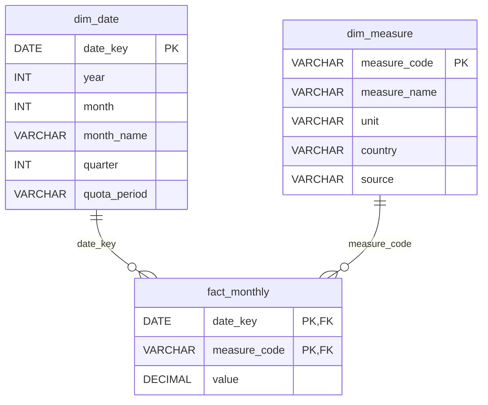

# SQL: the `dairy` database

This folder holds the SQL scripts for the `dairy` database in SQL Server. The database stores the clean monthly dairy data from `notebook 1`, so it can be queried with SQL and connected to Power BI.

## Files

The scripts are numbered in the order they are run.

| File | What it does |
|---|---|
| `00_create_database.sql` | Creates the `dairy` database |
| `01_create_tables.sql` | Creates the three tables: `dim_date`, `dim_measure` and `fact_monthly` |

The tables are filled from Python in `notebooks/2_sql_database.ipynb`.

The scripts are written in T-SQL (Microsoft SQL Server) and were run in SQL Server Management Studio (SSMS).

## Database design

The database uses a star schema: one fact table with the numbers, linked to two dimension tables that describe them.

- `fact_monthly` holds the numbers: one row per month and measure.
- `dim_date` describes each month: year, month, quarter and quota period.
- `dim_measure` describes each measure: name, unit, country and source table.

## Tables

### `dim_date`

One row per month, January 1975 to August 2026 (620 rows).

| Column | Type | Description |
|---|---|---|
| `date_key` | `DATE` | First day of the month. Primary key |
| `[year]` | `INT` | Year |
| `[month]` | `INT` | Month number, 1 to 12 |
| `month_name` | `VARCHAR(10)` | Month name, e.g. January |
| `[quarter]` | `INT` | Quarter, 1 to 4 |
| `quota_period` | `VARCHAR(20)` | `pre-quota` (before April 1984), `quota` (April 1984 to March 2015) or `post-quota` (from April 2015) |

`year`, `month` and `quarter` are in square brackets because they are also names of T-SQL functions.

### `dim_measure`

One row per measure (8 rows).

| `measure_code` | `measure_name` | `unit` | `country` | `source` |
|---|---|---|---|---|
| `intake_ml` | Domestic milk intake by creameries and pasteurisers | million litres | Ireland | CSO AKM01 |
| `fat_pct` | Fat content of milk intake | % | Ireland | CSO AKM01 |
| `protein_pct` | Protein content of milk intake | % | Ireland | CSO AKM01 |
| `liquid_sales_ml` | Milk sales for human consumption | million litres | Ireland | CSO AKM02 |
| `butter_kt` | Butter production | thousand tonnes | Ireland | CSO AKM03 |
| `cheese_kt` | Cheese production | thousand tonnes | Ireland | CSO AKM03 |
| `smp_kt` | Skimmed milk powder production | thousand tonnes | Ireland | CSO AKM03 |
| `canada_total_ml` | Total milk production | million litres | Canada | Statistics Canada 32-10-0113-01 |

`measure_code` is the primary key (`VARCHAR(30)`). The other columns are `VARCHAR` text.

### `fact_monthly`

One row per month and measure (4,538 rows).

| Column | Type | Description |
|---|---|---|
| `date_key` | `DATE` | Month. Foreign key to `dim_date` |
| `measure_code` | `VARCHAR(30)` | Measure. Foreign key to `dim_measure` |
| `value` | `DECIMAL(12, 3)` | The value, in the unit given in `dim_measure`. `NOT NULL` |

The primary key is (`date_key`, `measure_code`), so each month has at most one value per measure.

Row counts are for the data downloaded in October 2026.

## Design decisions

**Star schema.** The numbers are in one table and the descriptions in two small tables. Queries need only simple joins, and Power BI works best with this layout.

**Long format for the fact table.** `fact_monthly` has one row per month and measure, not one column per measure. A new measure is added as new rows, so the table design does not change.

**Missing values have no row.** A row in `fact_monthly` is a value that was published. `value` is `NOT NULL`, and missing values are not filled in or estimated. Six Irish measures start in January 1980, cheese production ends in December 2025, and skimmed milk powder has 40 single missing months between 2005 and 2025. `dim_date` has every month, so gaps can be found by joining it to `fact_monthly`.

**Quota period stored in `dim_date`.** The EU milk quota period of each month is stored once in `dim_date`. Queries can group by `quota_period` without repeating the date rules.

**Loading in Python, analysis in SQL.** The SQL scripts create the empty tables. Notebook 2 loads the clean data with pandas and SQLAlchemy. The analysis queries are written in SQL.

## How to rebuild the database

Requirements: SQL Server (the Developer edition is free), ODBC Driver 18 for SQL Server, and the Python packages in `requirements.txt`.

1. Run `00_create_database.sql` in SSMS to create the `dairy` database.
2. Run `01_create_tables.sql` in SSMS to create the empty tables.
3. Run `notebooks/1_data_preparation.ipynb` to create the clean CSV files in `data/processed`.
4. Run `notebooks/2_sql_database.ipynb` to load the tables.

The notebook connects to a local SQL Server (`localhost`) with Windows Authentication. For another server, change the connection string in notebook 2.

Running `01_create_tables.sql` again drops and recreates the tables, so all rows are deleted. Notebook 2 can be re-run at any time, because it clears the tables before loading.