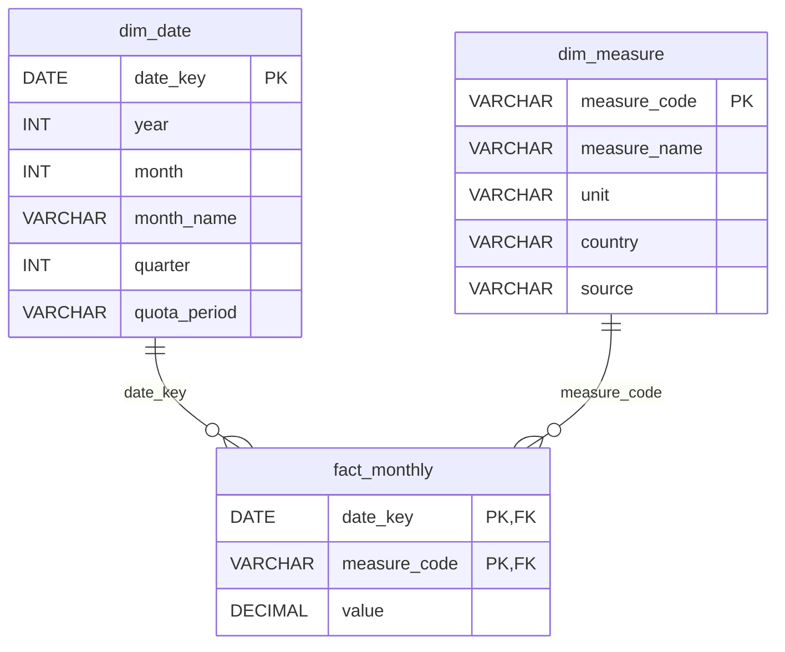

# SQL: the `dairy` database

This folder holds the SQL scripts for the `dairy` database in SQL Server. The database stores the clean monthly dairy data from `notebook 1`, so it can be queried with SQL and connected to Power BI.

## Files

The scripts are numbered in the order they are run.

| File | What it does |
|---|---|
| `00_create_database.sql` | Creates the `dairy` database |
| `01_create_tables.sql` | Creates the three tables: `dim_date`, `dim_measure` and `fact_monthly` |

The tables are filled from Python in `notebooks/2_sql_database.ipynb`.

The scripts are written in T-SQL (Microsoft SQL Server) and were run in SQL Server Management Studio (SSMS).

## Database design

The database uses a star schema: one fact table with the numbers, linked to two dimension tables that describe them.

- `fact_monthly` holds the numbers: one row per month and measure.
- `dim_date` describes each month: year, month, quarter and quota period.
- `dim_measure` describes each measure: name, unit, country and source table.